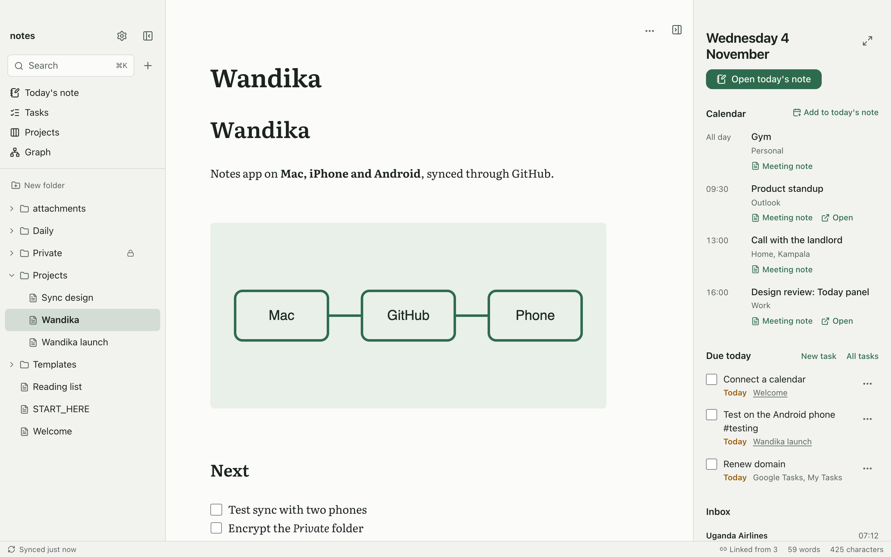
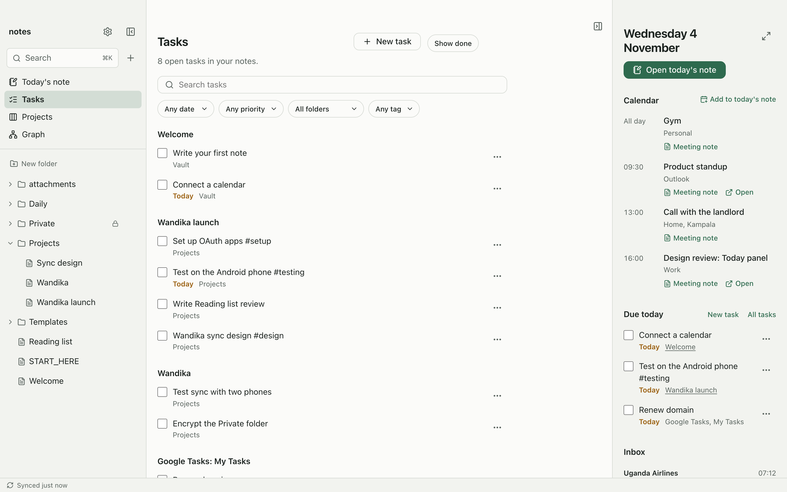
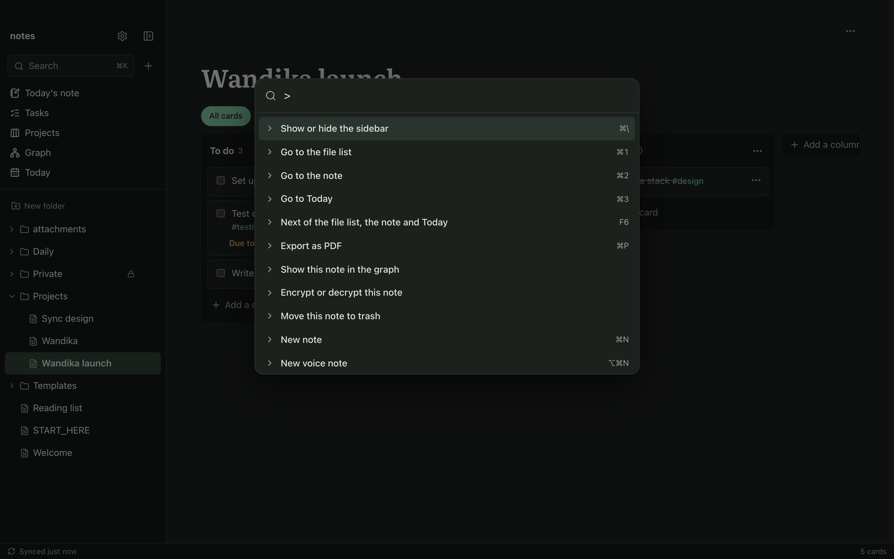
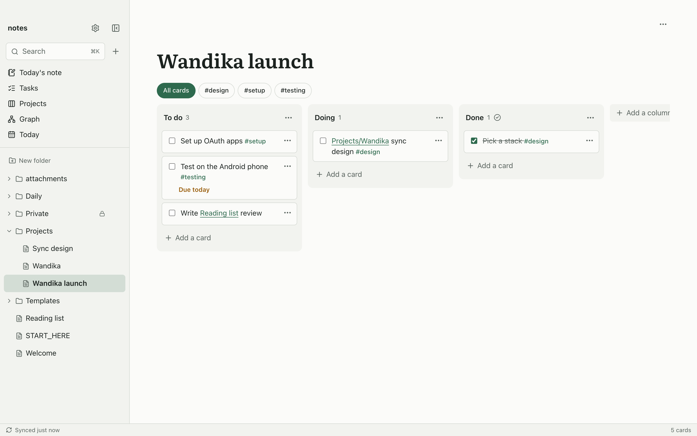
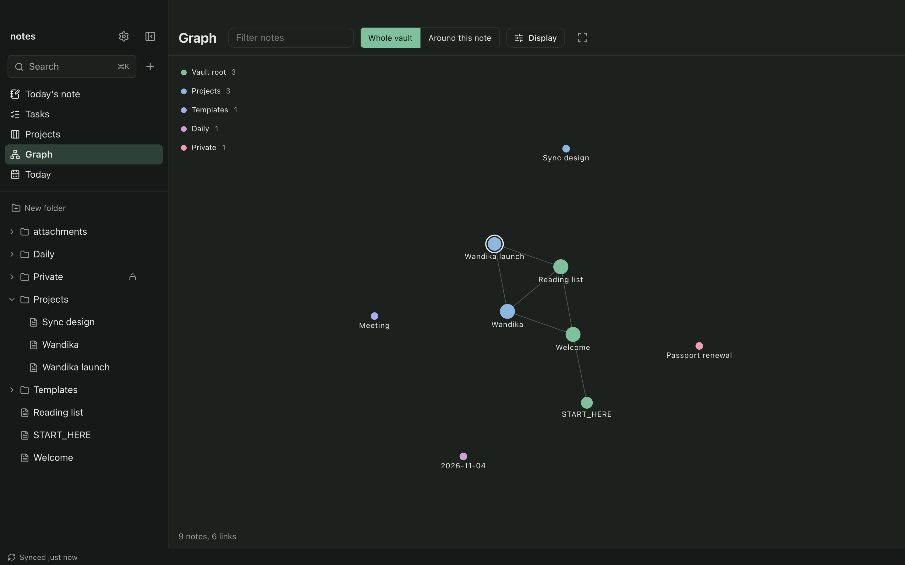
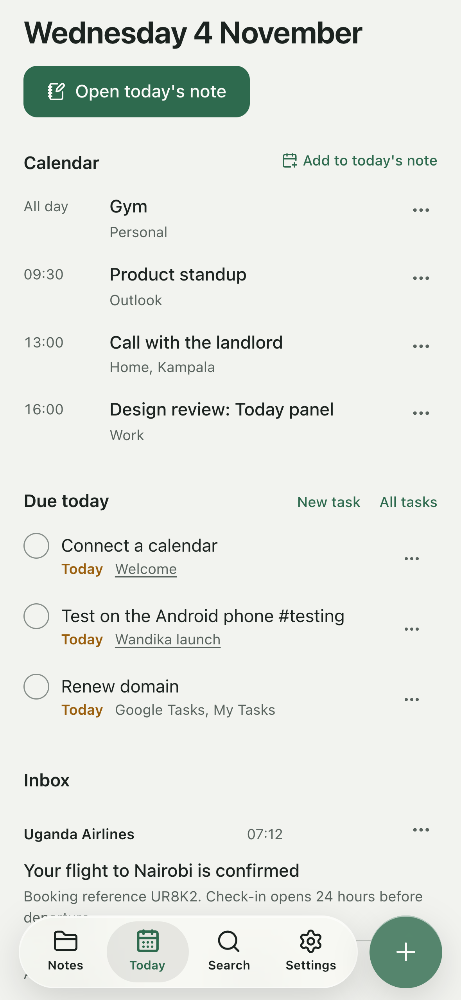
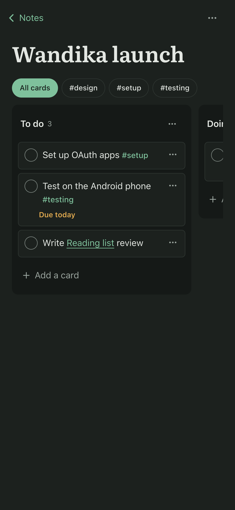
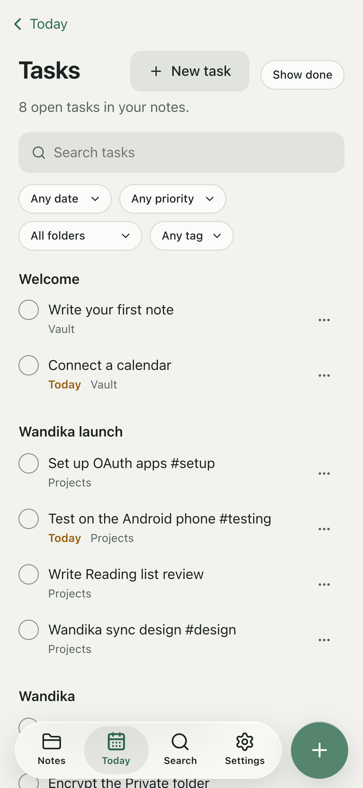
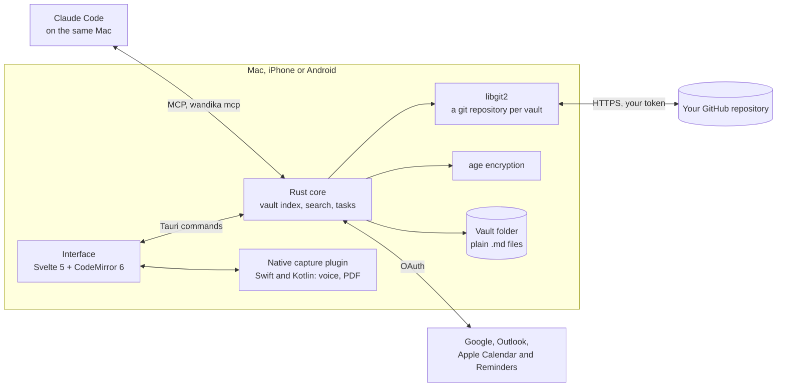
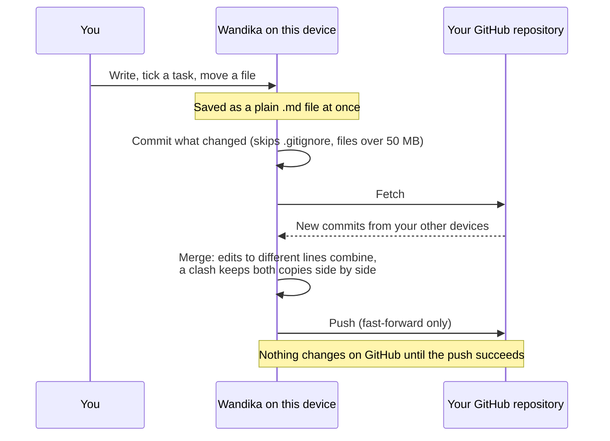

# Wandika

Markdown notes for Mac, iPhone and Android, kept in a GitHub repository you choose.

Your notes are plain `.md` files in an Obsidian-compatible vault. Wandika syncs them through your
own GitHub repository, so there's no Wandika account and no Wandika server. Today's calendar,
mail and tasks sit beside your notes, and everything works from the keyboard.

<picture>
  <source media="(prefers-color-scheme: dark)" srcset="docs/images/mac-note-dark.png">
  
</picture>

> Wandika is in beta. Your notes stay plain Markdown files, on your devices and in your GitHub
> repository, whatever happens to the app.

## Get it

| Platform | How |
|---|---|
| Android | The APK from [Releases](https://github.com/jordan-jakisa/wandika/releases) (beta). |
| iPhone | TestFlight, for invited testers while the beta runs. |
| Mac | Build it from source (below). A signed download comes with the next release. |

## What it does

**Write**

- A live-preview Markdown editor (CodeMirror 6): headings, lists, tables, callouts, images,
  embedded notes, properties and Mermaid diagrams, drawn as you type.
- `[[` links notes, `#` tags them, and `/` opens commands: headings, lists, a table, code, a
  callout, a diagram, today's date, a picture, a drawing, a voice note or a template.
- Smart lists: Tab, outdent and ⌥↑/⌥↓ move an item with everything nested under it.
- Several cursors (⌥-click, ⌥-drag for a column), optional Vim keys and line numbers.
- Drawings with a pen, a finger or a trackpad, saved as SVG beside the note.
- Voice notes turned into text on the device, offline. On iPhone, a Lock Screen and Control
  Center button records one without opening the app.
- Export a note as a PDF: the Mac's print panel, the iPhone's share sheet, Android's print dialog.

**Plan the day**

- Today: your calendar (Google, Outlook, Apple Calendar), what's due, and your inbox, beside the
  note you're writing. Turn a meeting or an email into a note or a task.
- Tasks from every note in one list, in the
  [Obsidian Tasks](https://publish.obsidian.md/tasks) format, with Google Tasks and Apple
  Reminders beside them. Filter by date, priority, folder and tag; pin, archive or swipe them.
- Kanban boards in the Obsidian Kanban format, and a graph of how notes link.

**Keep it yours**

- Sync through any GitHub repository you pick, or keep a vault on one device with no account.
- Encrypt any note or folder. Encrypted notes are standard [age](https://age-encryption.org)
  files, unreadable on GitHub.
- Claude Code on the Mac can read and write your notes and tasks through Wandika (it never sees
  encrypted notes or your mail).

## A closer look

| | |
|---|---|
|  |  |
| **Tasks** from every note, filtered in one row. | **Every command** from the keyboard, with its shortcut. You can change any shortcut in Settings. |
|  |  |
| **Boards** that Obsidian's Kanban plugin opens too. | **The graph**, for the whole vault or around one note. |

<p align="center">
  
  
  
</p>

## How it works

Wandika is a [Tauri 2](https://tauri.app) app. One Rust core does the work (the vault, search,
sync, encryption and the connections to calendars and mail), and a Svelte interface draws it on
every platform. Notes never pass through a server of ours: the device talks to GitHub, Google,
Microsoft and Apple directly.



### One sync

Every vault is a real git repository on the device, kept in Wandika's own storage, so a vault
folder (an Obsidian vault in iCloud, say) never gets a `.git` folder from us. A sync runs 20
seconds after you stop typing, every 3 minutes while the app is in front, and whenever you ask.



A sync that would delete more than 25 files and a fifth of the vault stops and asks first, so a
moved folder can't empty the vault on every device. The full rules, and how they stay within
GitHub's limits, are in [docs/sync.md](docs/sync.md).

### The vault on disk

```text
your-vault/
├── .obsidian/            Obsidian's settings, read for daily notes, templates and new notes
├── attachments/          pictures and drawings (SVG) a note embeds
├── Daily/2026-11-04.md   today's note, with voice notes under its Notes heading
├── Projects/Launch.md    a Kanban board is a note too
├── Private/Plan.md.age   an encrypted note
└── Archive.md            tasks you archived
```

Open the same folder in Obsidian and everything is there.

## Privacy

No accounts, analytics, ads or tracking. Sign-in tokens stay in the system keychain (or the app's
private storage on Android). Voice notes are turned into text on the device and the audio is never
kept. Details: [PRIVACY.md](PRIVACY.md).

## Develop

```bash
cp .env.example .env   # add OAuth client IDs: docs/setup.md
npm install
npm run tauri dev
```

The interface also runs in a plain browser with a demo vault, for design work:
`npm run dev`, then open `http://localhost:1420/?mock=vault`.

| | |
|---|---|
| `src/` | The interface: Svelte 5 components, the CodeMirror editor (`src/lib/editor`) and app state. |
| `src-tauri/src/` | The Rust core: vault, sync, encryption, connectors, and the MCP server for Claude Code. |
| `src-tauri/plugins/capture/` | Native code for voice notes and PDF export (Swift for iPhone, Kotlin for Android). |
| `docs/` | Setup, sync design, store and privacy checks. |

Checks:

```bash
npm run check                       # types
npm test                            # interface tests (Vitest)
cd src-tauri && cargo test --lib    # Rust tests
```

Building for each platform, releases and signing: [docs/setup.md](docs/setup.md).
